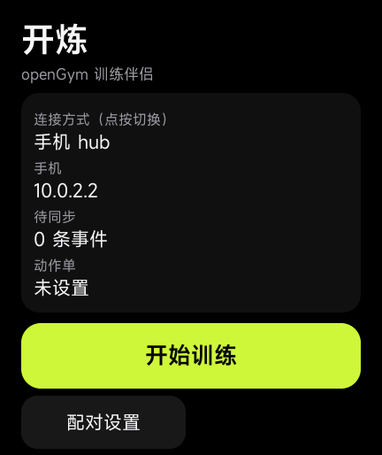

# 开炼（openGym_REDMIWatch）—— 红米 Watch 5 上的 openGym 手表端

## 为什么要在手腕上记组

练力量的人都懂：杠铃压在背上，手机在旁边躺着。做完一组想记重量，得擦手、掏手机、
解锁、找到那一条、输数字——组间 90 秒的休息，一半耗在操作上；第二组该上多少，
全靠脑子记。

开炼把这些搬到手腕上：

- **抬腕看处方**：下一组练什么、上多少重量、做几次，休息倒计时就在表盘上走
- **一键记组**：做完按一下，重量次数自动回传手机落库，网页端历史与 PR 随之更新
- **临场调整**：重量 ±2.5/±0.5、次数 ±1、跳过这组、单侧 L/R 分开记，全程不碰手机
- **断联不丢数**：没同步上的事件留在手表队列，回到手机旁自动补投，确认后才删，不丢不重
- **数据全在你手里**：从手表经你自己的手机落到你自己的 openGym 服务器，不经过任何第三方云
- **热量心率不重记**：时长/热量/心率交给手表自带的运动模式，训练记录归 openGym，两边不打架

上游 openGym 的 Apple Watch 版要 iPhone + Apple Watch 才能玩；这个项目给安卓用户
同一套体验——一块红米 Watch 5、一部安卓手机，免刷机、全开源。

[openGym](https://github.com/DuarteSantos8/openGym)（AGPL-3.0 的自托管健身记录网页）
的红米 Watch 5 快应用客户端：手表上记每组（重量×次数）、看下一组练什么、组间休息
倒计时；热量/心率/时间由手表自带的运动模式统计，两边并行互不干扰。

| 主页 | 记组 | 有氧组 |
|---|---|---|
|  |  |  |

```
红米 Watch 5 (快应用)                  安卓 openGym App (Capacitor)
  GET  /watch/snapshot ──蓝牙代理──▶  小米运动健康(转发) → 本地HTTP服务(前台服务 :8765)
  POST /watch/events   ───────────▶  drainWatchEvents() → applyEvents 合入 → pushState
  POST /watch/ack      ───────────▶  按 id 确认 → 手表删本地待发队列
```

架构与上游的 Apple Watch 版同构：手机 = 处方引擎 + 同步枢纽（hub），手表 = 纯执行器。
手表从手机拉快照，把记组/开局/结束以事件上报（ack 后删队、离线自动补投），训练落库由
手机完成，再经 openGym 的 sync 到 PC 网页端。组数与体量口径、PR、跳过、单侧 L/R、
热身/超级组标签与 Apple Watch 版逐条对齐（session-core 状态机 1:1 移植，138 项 Node
测试加 54 项 JVM 契约测试兜底）。

## 组成

| 目录 | 内容 |
|---|---|
| `watch-app/src` | 快应用源码（Vela 引擎，红米 Watch 5 实测） |
| `watch-app/hub` | 手机端协议核心（纯 Java）+ PC JVM 契约测试 |
| `watch-app/test` | Node 自动化测试（桩模块注入，无需真机） |
| `watch-app/scripts` | rpk 打包、动作名表生成、模拟器走查脚本 |
| `watch-app/vendor` | 上游 openGym 的动作名数据（AGPL-3.0） |
| `phone` | 集成进安卓 openGym App 的 4 个 Java 类 + 前端同步库 + 接线指南 |
| `docs` | 协议规格（v2.1：快照/事件/ack/休息同步/会话过期）、安卓 hub 设计、session-core 移植 |

## 快速开始

1. 手机 APK：按 [phone/README.md](phone/README.md) 把 watch hub 集成进上游安卓
   App 并构建（PC 服务器侧零改动）。
2. 手表 rpk：`watch-app/scripts/package-rpk.cmd`（详见
   [watch-app/README.md](watch-app/README.md)「七、打包」）。
3. 真机安装：AstroBox 免刷机推送 rpk（见 watch-app/README「二」）。
4. 配对：手机常驻通知显示「IP · 8 位 token」，手表输入即配对，约 1 分钟。

## 兼容性与已知限制

- 实测机型：红米 Watch 5（Vela 引擎快应用）。其他型号未验证，欢迎反馈。
- 需要：安卓手机装集成 hub 的 openGym App、小米运动健康（蓝牙代理）、训练时手机在身边。
- MIUI/HyperOS 杀后台、无心率写入通道、休息倒计时同步边界等已知限制，见
  [watch-app/README.md](watch-app/README.md)「八」。
- 安装用社区工具 AstroBox + 米坛社区（bandbbs.cn），不改固件；变砖风险自负，
  动手前先读 watch-app/README「二」的注意事项。

## 文档

- [docs/watch-protocol.md](docs/watch-protocol.md) — 手表↔hub 协议 v2.1（快照/事件/ack 契约）
- [docs/android-hub.md](docs/android-hub.md) — 安卓 hub 设计与踩坑
- [docs/rest-sync.md](docs/rest-sync.md) — 休息倒计时双向同步（v2.1）
- [docs/session-expiry.md](docs/session-expiry.md) — 本地会话 6 小时过期
- [docs/session-core.md](docs/session-core.md) — 组数/体量/PR 状态机（Apple Watch 版 1:1 移植）

## 许可

与上游 openGym 一致，以 AGPL-3.0 发布（见 [LICENSE](LICENSE)）。本仓库是上游的衍生
作品：`watch-app/vendor/` 里直接放了上游的动作名数据，复用自上游的协议（配对码、sync）
版权归上游作者，对上游的改动也以同一许可开放。
