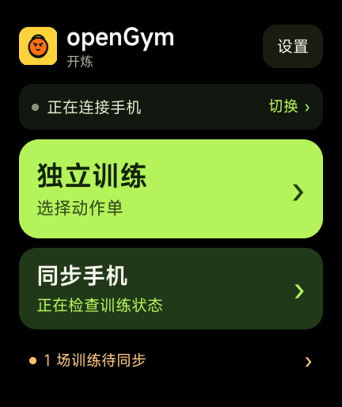
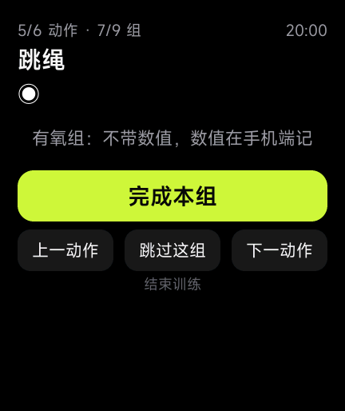

# 开炼（openGym_REDMIWatch）—— 红米 Watch 5 上的 openGym 手表端

## 为什么要在手腕上记组

练力量的人都懂：杠铃压在背上，手机在旁边躺着。做完一组想记重量，得擦手、掏手机、
解锁、找到那一条、输数字——组间 90 秒的休息，一半耗在操作上；第二组该上多少，
全靠脑子记。

开炼把这些搬到手腕上：

- **抬腕看处方**：下一组练什么、上多少重量、做几次，休息倒计时就在表盘上走
- **一键记组**：做完按一下，记录重量和次数，完成同步后可在 openGym 网页查看历史与 PR
- **临场调整**：重量 ±2.5/±0.5、次数 ±1、跳过这组、单侧 L/R 分开记，全程不碰手机
- **离线训练**：电脑配对后，手表可从缓存中选择动作单，练完后暂存整场训练，恢复连接再补传
- **自托管**：训练记录可直传自己的 openGym 服务器，也可通过安卓 openGym App 中转
- **热量心率不重记**：时长/热量/心率交给手表自带的运动模式，训练记录归 openGym，两边不打架

[openGym](https://github.com/DuarteSantos8/openGym)（AGPL-3.0 的自托管健身记录网页）
的红米 Watch 5 快应用客户端：手表上记每组（重量×次数）、看下一组练什么、组间休息
倒计时；热量/心率/时间由手表自带的运动模式统计，两边并行互不干扰。

| V4 首页 | 记组 | 有氧组 |
|---|---|---|
|  |  |  |

```
红米 Watch 5 (快应用)            安卓 openGym App (Capacitor)
  GET  /watch/snapshot ─────▶  读取动作单和进行中的训练
  POST /watch/events   ─────▶  接收训练事件，按 id 回传 acked
```

手机自动配对通过小米系统通道，手动配对通过手机 HTTP `:8765`。收到 `acked` 后，手表移除对应的待发事件。手机将训练写入历史，再通过 openGym 同步到电脑。手表的配对设置也支持电脑直连。

## 组成

| 目录 | 内容 |
|---|---|
| `watch-app/src` | 快应用源码（Vela 引擎，红米 Watch 5 实测） |
| `watch-app/hub` | 手机端协议核心（纯 Java）+ PC JVM 契约测试 |
| `watch-app/test` | Node 自动化测试（桩模块注入，无需真机） |
| `watch-app/scripts` | rpk 打包、动作名表生成、模拟器走查脚本 |
| `watch-app/vendor` | 上游 openGym 的动作名数据（AGPL-3.0） |
| `phone` | 集成进安卓 openGym App 的 4 个 Java 类 + 前端同步库 + 接线指南 |
| `docs` | 协议规格（v2.1：快照/事件/ack/休息同步/会话过期）、安卓 hub 设计、session-core 移植 |

## 快速开始

**当前手表版本为 1.0.10。** V4 首页可直接进入独立训练或同步手机，动作单超出一屏时可上下滑动。配套安卓 App 使用 1.0.8 手机同步修复版。[下载正式签名 RPK](https://raw.githubusercontent.com/nine-orders/openGym_REDMIWatch/astrobox-release-1.0.10/astrobox/openGym-RedmiWatch5-LTNS-1.0.10.rpk) · [首页实施与验收记录](docs/watch-home-v4-20261126.md) · [手机同步修复记录](docs/phone-sync-fix-20261126.md)

平时只戴手表训练，可以使用[电脑配对与离线训练](watch-app/README.md#电脑配对与离线训练)。
先在电脑 openGym 配对并拉取动作单，训练后记录存于手表，回到电脑所在网络后自动补传。

下载 RPK 后，可用 AstroBox 安装到红米 Watch 5。已有同签名版本时，可覆盖更新。需要自行构建时，使用 `watch-app/scripts/package-rpk.cmd`。[安装与打包说明](watch-app/README.md)

使用手机中转时，在手机上打开配套 openGym App，按[手机配对步骤](watch-app/README.md#手机配对与训练)连接。自行构建 APK 可参考[安卓集成指南](phone/README.md)。

## 兼容性与已知限制

- 电脑直连已通过 15 场离线存储和批量补传的自动化测试。真机容量和实际离线 15 天仍待验证。
- 实测机型：红米 Watch 5（Vela 引擎快应用）。其他型号未验证，欢迎反馈。
- 手机中转需要：安卓手机装集成 hub 的 openGym App、小米运动健康（蓝牙代理）、训练时手机在身边。
- MIUI/HyperOS 杀后台、无心率写入通道、休息倒计时同步边界等已知限制，见
  [watch-app/README.md](watch-app/README.md)「八」。
- 安装用社区工具 AstroBox + 米坛社区（bandbbs.cn），不改固件；变砖风险自负，
  动手前先读 watch-app/README「二」的注意事项。

## 文档

- [安装包与历史版本](docs/release-archive.md)
- [产品需求与验收](docs/prd.md)
- [docs/watch-protocol.md](docs/watch-protocol.md) — 手表↔hub 协议 v2.1（快照/事件/ack 契约）
- [docs/android-hub.md](docs/android-hub.md) — 安卓 hub 设计与踩坑
- [docs/rest-sync.md](docs/rest-sync.md) — 休息倒计时双向同步（v2.1）
- [docs/session-expiry.md](docs/session-expiry.md) — 本地会话 6 小时过期
- [docs/session-core.md](docs/session-core.md) — 组数/体量/PR 状态机（Apple Watch 版 1:1 移植）

## 许可

与上游 openGym 一致，以 AGPL-3.0 发布（见 [LICENSE](LICENSE)）。本仓库是上游的衍生
作品：`watch-app/vendor/` 里直接放了上游的动作名数据，复用自上游的协议（配对码、sync）
版权归上游作者，对上游的改动也以同一许可开放。
